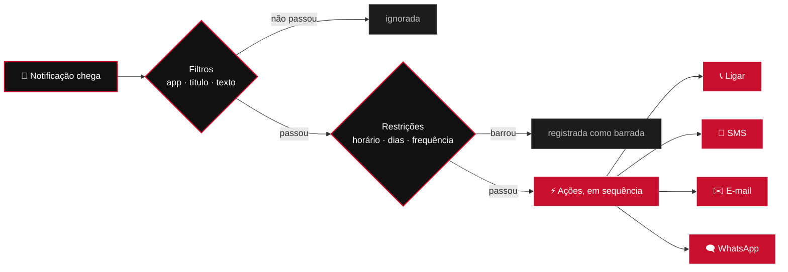
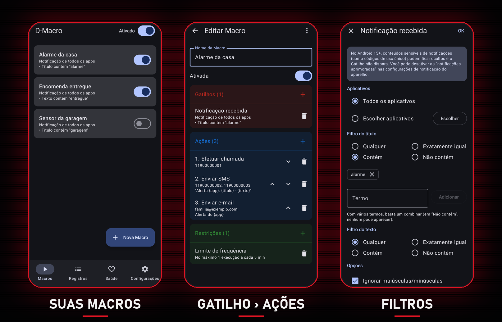
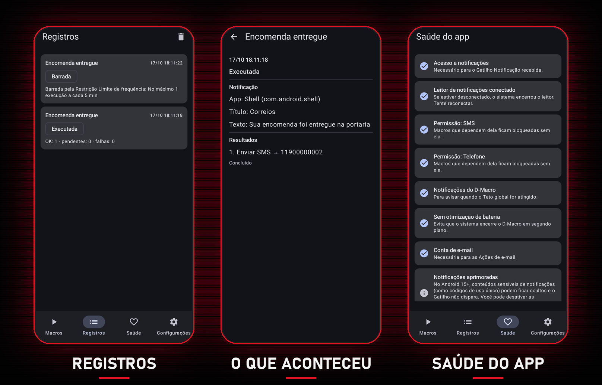

<p align="center">
  
</p>

<p align="center">
  <a href="https://github.com/djavan-ryuuzaki/d-macro/releases/latest"></a>
  
  
  
</p>

<h3 align="center">Quando o seu celular recebe uma notificação, o D-Macro age por você.</h3>

<p align="center">
  Ligue para alguém, mande SMS, e-mail e WhatsApp para vários contatos, repassando o conteúdo da notificação.<br>
  No estilo MacroDroid, sem conta, sem servidor e sem anúncios.
</p>

<p align="center">
  <a href="https://github.com/djavan-ryuuzaki/d-macro/releases/latest">
    
  </a>
</p>

---

## ⚡ Como funciona

Cada **Macro** junta três peças: o **Gatilho** (qual notificação), as **Restrições** (em que condições) e as **Ações** (o que fazer).



**Exemplo:** o app do alarme notifica *"Alarme: sensor da sala"* → o D-Macro liga para você, manda SMS para dois vizinhos com `Alerta {app}: {titulo} - {texto}` e um e-mail para a família.

<p align="center">
  
</p>

## 🧰 O que ele faz

<table>
  <tr>
    <td width="50%" valign="top">
      <h4>🔔 Gatilho: Notificação recebida</h4>
      Escolha os apps e filtre pelo título e pelo texto: <i>qualquer</i>, <i>igual</i>, <i>contém</i> ou <i>não contém</i>, com vários termos. Ignora notificações fixas e atualizações repetidas da mesma notificação.
    </td>
    <td width="50%" valign="top">
      <h4>📞 Ligar · 💬 SMS · ✉️ E-mail</h4>
      Chamada pelo chip padrão, SMS para vários contatos (com nova tentativa se falhar) e e-mail pela sua própria conta via SMTP (Gmail, Outlook ou outro), com reenvio quando a rede volta.
    </td>
  </tr>
  <tr>
    <td valign="top">
      <h4>🗨️ WhatsApp</h4>
      Abre a conversa e toca em <b>Enviar</b> por você, pela sua conta. Com a tela bloqueada, a mensagem espera o desbloqueio por até 30 minutos.
    </td>
    <td valign="top">
      <h4>🏷️ Marcadores</h4>
      Repasse o conteúdo da notificação nas mensagens: <code>{app}</code> <code>{titulo}</code> <code>{texto}</code> <code>{data}</code> <code>{hora}</code>.
    </td>
  </tr>
  <tr>
    <td valign="top">
      <h4>⏱️ Restrições</h4>
      Faixa de horário (inclusive passando da meia-noite), dias da semana e limite de frequência (toda Macro nova já vem com 1 execução a cada 5 minutos).
    </td>
    <td valign="top">
      <h4>🧪 Teste e Registros</h4>
      Teste qualquer Macro com valores de exemplo e veja no histórico o que disparou, o que foi barrado e o resultado de cada envio.
    </td>
  </tr>
</table>

<p align="center">
  
</p>

## 🛡️ Feito para não sair do controle

- **Chave geral:** um toque pausa todas as Macros.
- **Teto global:** no máximo 20 SMS, 5 chamadas e 20 mensagens de WhatsApp por hora, sem como desligar. Se passar disso, o envio é bloqueado e você é avisado.
- **Saúde do app:** mostra o que falta (permissões, acesso a notificações, bateria) e leva direto à tela certa para corrigir.
- **Privacidade:** nada sai do aparelho além das ligações e mensagens que você configurou. Sem analytics, sem backup na nuvem; a senha do e-mail fica criptografada.

## 📲 Instalar

O D-Macro é distribuído só pelo **[GitHub Releases](https://github.com/djavan-ryuuzaki/d-macro/releases/latest)**. Requer Android 8.0 ou mais novo.

1. No celular, baixe o arquivo `D-Macro-vX.Y.Z.apk` da release mais recente.
2. Abra o arquivo e permita **instalar apps desconhecidos** para o app que o abriu (navegador ou Arquivos). Se o Play Protect avisar, toque em **Instalar mesmo assim**.

<details>
<summary><b>🇧🇷 O Android pediu "desenvolvedor verificado"? (Brasil, desde 30/09/2026)</b></summary>
<br>

O Android passou a exigir, no Brasil, que apps venham de desenvolvedores verificados pelo Google, mesmo fora da Play Store. O D-Macro ainda não é registrado, então é preciso ativar o **fluxo avançado** uma única vez:

1. Configurações › Sobre o telefone › toque 7 vezes em **Número de compilação** para liberar as Opções do desenvolvedor.
2. Opções do desenvolvedor › **Permitir apps de desenvolvedores não verificados**.
3. Leia os avisos e aguarde a espera de 24 horas que o Android impõe; depois volte à mesma tela para concluir.

Depois disso, a instalação e as atualizações funcionam normalmente.
</details>

<details>
<summary><b>⚙️ Primeiro uso</b></summary>
<br>

Abra a aba **Saúde** e deixe tudo verde: acesso a notificações, SMS, Telefone, notificações do D-Macro, bateria e, se for usar WhatsApp, o serviço de acessibilidade.

- **Interruptor bloqueado?** O Android trava o acesso a notificações e a acessibilidade de apps instalados fora da loja. Libere em Configurações › Apps › D-Macro › ⋮ › **Permitir configurações restritas** (a Saúde mostra o passo a passo).
- **Samsung:** siga também o guia de "Apps que nunca entram em suspensão", para o sistema não encerrar o D-Macro.
- **E-mail:** em Configurações, cadastre sua conta. No Gmail, use uma *senha de app*, não a senha normal.
</details>

<details>
<summary><b>🔄 Atualizar</b></summary>
<br>

Baixe o APK da nova release e instale por cima: suas Macros são mantidas. O app não se atualiza sozinho; acompanhe a página de releases (ou use um app como o Obtainium, que avisa quando sai uma versão nova).
</details>

---

## 🛠️ Para desenvolvedores

Kotlin, Jetpack Compose (Material 3), Hilt, Room, WorkManager e Jakarta Mail. O motor de regras é Kotlin puro, desenvolvido com TDD.

| Documento | Conteúdo |
|---|---|
| [docs/SPEC.md](docs/SPEC.md) | Especificação completa |
| [CONTEXT.md](CONTEXT.md) | Glossário do domínio |
| [docs/adr](docs/adr/) | Decisões de arquitetura |
| [docs/tickets](docs/tickets/README.md) | Tickets e pontos de teste |
| [docs/roteiro-de-aceite.md](docs/roteiro-de-aceite.md) | Roteiro de testes no aparelho |

```bash
./gradlew testDebugUnitTest   # testes
./gradlew assembleDebug       # APK de depuração
```

<details>
<summary><b>📦 Publicar uma release</b></summary>
<br>

O workflow [`.github/workflows/release.yml`](.github/workflows/release.yml) roda os testes, gera o APK assinado e cria a release a cada tag `vX.Y.Z` (com hífen, como `v0.3.0-beta1`, sai como pré-release). A versão do app vem da tag: `v1.2.3` vira `versionName 1.2.3` e `versionCode 10203`.

**Configuração única**

1. Crie a chave de assinatura e **guarde o arquivo e as senhas em lugar seguro** (sem ela não dá para publicar atualizações que instalem por cima):

   ```bash
   keytool -genkeypair -v -keystore dmacro-release.jks -alias dmacro -keyalg RSA -keysize 4096 -validity 10000
   ```

2. No GitHub, em Settings › Secrets and variables › Actions › **New repository secret**, crie os segredos `DMACRO_KEYSTORE_BASE64`, `DMACRO_STORE_PASSWORD`, `DMACRO_KEY_ALIAS` e `DMACRO_KEY_PASSWORD`. Para gerar o valor de `DMACRO_KEYSTORE_BASE64` (já copiado para a área de transferência):

   ```powershell
   # Windows (PowerShell)
   [Convert]::ToBase64String([IO.File]::ReadAllBytes("dmacro-release.jks")) | Set-Clipboard
   ```

   ```bash
   # Linux / macOS / Git Bash
   base64 -w0 dmacro-release.jks
   ```

**Cada release**

```bash
git tag v0.2.0
git push origin v0.2.0
```

Para gerar o APK assinado localmente, crie um `keystore.properties` na raiz (ignorado pelo git) com `STORE_FILE`, `STORE_PASSWORD`, `KEY_ALIAS` e `KEY_PASSWORD` e rode `./gradlew assembleRelease`.
</details>

<p align="center"><br><br><sub>Feito no Brasil 🇧🇷</sub></p>
